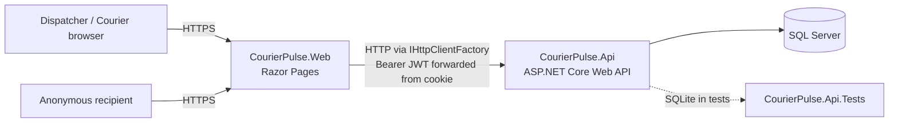

# CourierPulse


Courier dispatch and delivery-tracking platform built as two independent ASP.NET Core 8
microservices: a REST API with the business rules, and a Razor Pages frontend that talks to it
over plain HTTP.

## What it solves

A dispatcher creates a delivery order, the system hands it to the least-loaded available
courier in the right zone, and the courier walks it through pickup, transit and delivery while
anyone with the tracking code can watch its status without an account.

## Business rules

- **Order state machine.** Every order moves through `Pending → Assigned → PickedUp → InTransit
  → Delivered | Failed`, with `Cancelled` as an early exit from `Pending`/`Assigned`. Illegal
  transitions are rejected with a `409 Conflict` listing the states that *are* allowed next
  ([`OrderStateMachine`](src/CourierPulse.Api/Services/OrderStateMachine.cs)).
- **Zone-based, least-loaded auto-assignment.** Assigning an order picks the `Available` courier
  in the order's zone with the fewest active orders. Two dispatchers racing to assign the same
  order is a real race: assignment runs inside a retry loop that reloads the order on a
  concurrency conflict instead of corrupting state
  ([`AssignmentService`](src/CourierPulse.Api/Services/AssignmentService.cs)).
- **Portable optimistic concurrency.** Both `Courier` and `DeliveryOrder` carry an
  application-managed `RowVersion` token, re-stamped in `SaveChanges` rather than relying on a
  SQL Server-only `rowversion` column — the exact same concurrency check runs against SQL Server
  in production and SQLite in tests.
- **Idempotent delivery confirmation.** `PUT /api/orders/{id}/deliver` requires an
  `Idempotency-Key` header. If the order is already `Delivered`, a retried call (same key or a
  lost one from a flaky courier app) returns the existing order instead of failing or
  re-applying the delivery.
- **Ownership-scoped actions.** A courier can only transition or deliver orders currently
  assigned to them; dispatchers and admins bypass that check. Enforced in the service layer, not
  just in controllers, so it can't be bypassed by a new endpoint later.
- **N+1-free pagination.** `GET /api/orders` supports filtering by status/zone/overdue and pages
  through a single projected query (including the assigned courier's name) — no per-row
  round trips.
- **Overdue tracking.** An order is overdue once its promised delivery window has elapsed without
  a timely delivery; cancelled orders are never overdue, and a late-but-delivered order stays
  flagged for the dispatcher's visibility.
- **Privacy-conscious public tracking.** The anonymous tracking endpoint is rate-limited (30
  requests/minute) and never exposes pickup/dropoff addresses — only status, zone and timeline.

## Architecture



The frontend and backend are deployed as separate containers and only ever talk to each other
over HTTP, the same way they'd talk to any other client of the API.

## Technical decisions

- **Why an application-managed concurrency token instead of SQL Server `rowversion`?** The test
  suite runs against SQLite, which has no equivalent database-generated type. Stamping a new
  `Guid` into `RowVersion` on every insert/update and configuring it as an EF Core concurrency
  token gives identical optimistic-concurrency behavior on both providers.
- **Why a `DeliveryOrder`-owned idempotency key instead of a separate idempotency table?** The
  only operation that needs it is "confirm delivery", and the order's own `Delivered` status is
  already the natural idempotency boundary — a dedicated table would be more machinery for the
  same guarantee.
- **Why cookie-based sessions in the Razor Pages app instead of passing the JWT around
  manually?** `CourierPulse.Web` signs the user into its own cookie after calling
  `POST /api/auth/login`, stashing the API's JWT as a claim. A `DelegatingHandler`
  (`JwtForwardingHandler`) reads it back out and attaches it as a Bearer token on every
  outgoing API call, so page handlers never touch tokens directly.
- **Why does the Web project duplicate the API's DTOs instead of referencing the Api project?**
  They're meant to be independently deployable services that only talk over HTTP. A shared
  assembly would quietly turn that into a shared-library coupling.

## Endpoints

| Method | Path | Auth | Description |
| --- | --- | --- | --- |
| POST | `/api/auth/login` | Anonymous | Exchange email/password for a JWT |
| GET | `/api/couriers` | Admin, Dispatcher | List courier/dispatcher/admin accounts |
| POST | `/api/couriers` | Admin | Create a courier/dispatcher/admin account |
| PATCH | `/api/couriers/me/availability` | Courier | Set your own Available/Busy/Offline status |
| POST | `/api/orders` | Admin, Dispatcher | Create a pending delivery order |
| GET | `/api/orders` | Admin, Dispatcher | Paged, filterable order list (status/zone/overdue) |
| GET | `/api/orders/mine` | Courier | Your own assigned orders |
| GET | `/api/orders/{id}` | Admin, Dispatcher, owning Courier | Order detail |
| GET | `/api/orders/{id}/timeline` | Admin, Dispatcher, owning Courier | Status-change history |
| POST | `/api/orders/{id}/assign` | Admin, Dispatcher | Auto-assign to the least-loaded courier |
| POST | `/api/orders/{id}/transition` | Admin, Dispatcher, owning Courier | Move to the next valid status |
| PUT | `/api/orders/{id}/deliver` | Courier | Idempotent delivery confirmation (`Idempotency-Key` header required) |
| GET | `/api/public/tracking/{trackingCode}` | Anonymous, rate-limited | Public status + timeline lookup |

Full request/response contracts are in Swagger (`/swagger`) when running in Development.

## Demo accounts

Seeded automatically on first run (see [`DbSeeder`](src/CourierPulse.Api/Data/DbSeeder.cs)):

| Role | Email | Password |
| --- | --- | --- |
| Admin | `admin@courierpulse.dev` | `Admin#12345` |
| Dispatcher | `dispatcher@courierpulse.dev` | `Dispatcher#12345` |
| Courier (Downtown) | `courier.downtown@courierpulse.dev` | `Courier#12345` |
| Courier (North) | `courier.north@courierpulse.dev` | `Courier#12345` |

These are demo credentials for local use only — never reuse them for a real deployment.

## Running it

### With Docker Compose

```bash
docker compose up --build
```

- Frontend: http://localhost:8080
- API + Swagger: http://localhost:8081/swagger

### With `dotnet run`

Requires a local SQL Server instance; the connection string in
`src/CourierPulse.Api/appsettings.json` already matches the credentials docker-compose uses, so
the simplest path is `docker compose up sqlserver` and then run both projects locally:

```bash
dotnet run --project src/CourierPulse.Api   # http://localhost:5295, swagger at /swagger
dotnet run --project src/CourierPulse.Web   # http://localhost:5113
```

`CourierPulse.Web`'s `Api:BaseUrl` already points at the API's `dotnet run` port, so no extra
configuration is needed for the two to find each other locally.

## Testing

```bash
dotnet test
```

The suite runs entirely against SQLite (no SQL Server, no Docker required): some tests spin up a
throwaway in-memory database directly for service-layer logic, others boot the full API pipeline
through `WebApplicationFactory` for HTTP-level coverage of auth, roles, pagination and the order
lifecycle.

## Solution layout

- `src/CourierPulse.Api` — ASP.NET Core Web API (backend microservice)
- `src/CourierPulse.Web` — ASP.NET Core Razor Pages (frontend)
- `tests/CourierPulse.Api.Tests` — xUnit test suite for the API
